# PRISM · 粒子音乐播放器

一个沉浸式本地桌面音乐播放器：每次打开从**预先下载好的 Unsplash 图池与自定义图片**里随机抽取 10 张照片作为本次背景；屏幕中央的粒子球随音乐实时振动，**中心映射低频、最外围映射高频**，脉冲光带与星尘不断从中心向外扩散。

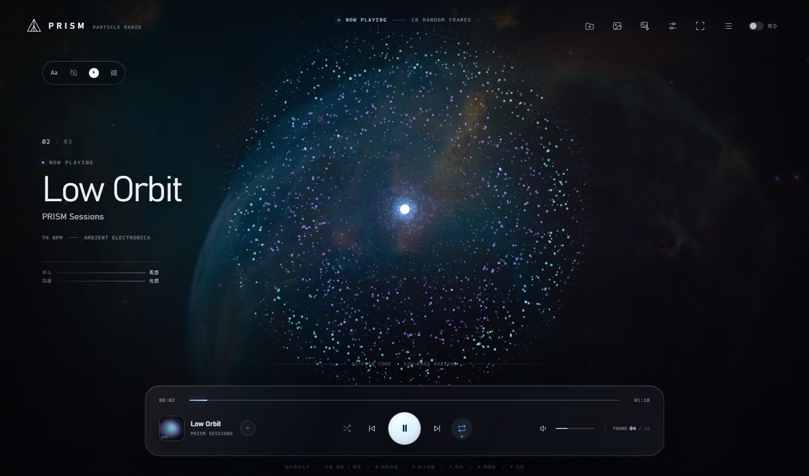

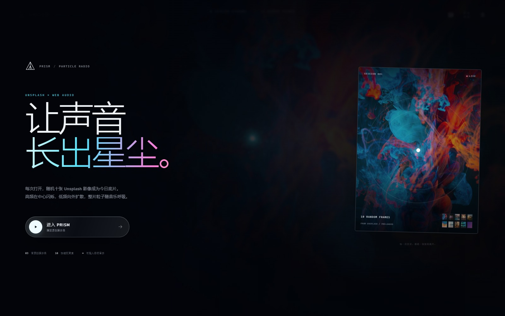

## 直接使用

桌面和开始菜单里已经生成了 **`PRISM 粒子音乐`** 快捷方式，双击即可打开原生桌面窗口，不需要浏览器、网址或本地服务器。

- 安装位置：`%LOCALAPPDATA%\Programs\PRISM`
- 主程序：`PRISM.exe`
- 双击快捷方式后点击 **进入 PRISM**，开始播放内置演示曲。
- 应用完全在本地运行，不访问 Unsplash 或任何第三方接口。

> 应用自带 Electron 运行时，因此安装目录约 371 MB；不依赖本机 Chrome/Edge，也不依赖 Python 或 Node.js。

### 卸载

删除以下内容即可：

- `%LOCALAPPDATA%\Programs\PRISM`
- 桌面与开始菜单中的 `PRISM 粒子音乐` 快捷方式
- 可选：`%APPDATA%\PRISM`（播放器缓存与音量等本地设置）

## 操作

| 操作 | 方式 |
| --- | --- |
| 播放 / 暂停 | 空格，或底部播放按钮 |
| 上一首 / 下一首 | `P` / `N`，或底部按钮 |
| 快进 / 后退 5 秒 | `→` / `←` |
| 音量 | `↑` / `↓`，或拖动音量条 |
| 静音 | `M` |
| 打开播放列表 | `Q`，或右上角列表按钮 |
| 粒子设置 | `S`，或右上角调节按钮 |
| 调整界面 / 字体大小 | 左上角界面控制栏的 `Aa` 按钮 |
| 隐藏文字（纯视觉） | 左上角眼睛按钮，或按 `H`；按 `Esc` / 点击右上角眼睛恢复 |
| 改变字体颜色 | 左上角界面控制栏的 `A` 色点按钮 |
| 显示 / 隐藏歌词 | `L`，或左上角界面控制栏的 `词` 按钮 |
| 导入歌词 | 歌词面板 → 导入 LRC |
| 在线搜索同步歌词 | 歌词面板 → 填写歌手 + 歌名 → 搜索 |
| 显示 / 隐藏翻译 | 歌词面板 → 显示翻译开关 |
| 歌词字号 | 歌词面板 → 歌词大小（只影响歌词，不缩放整个界面） |
| 歌词显示行数 | 歌词面板 → 显示行数（1–6 行，翻译计入行数） |
| 3D 球形粒子（实验） | 粒子设置 → 3D 球形开关，或按 `3`；机位按钮 / 自动段落切机位 / 过渡曲线 |
| Color Hunt 配色 | 粒子设置 → 配色方案，点击任意一套四色配色，同时改变界面与粒子颜色 |
| 搜索播放列表 | 播放列表顶部 → 输入歌名、歌手或专辑 |
| 专辑墙 | 打开播放列表 → 右上角网格按钮 |
| 显示 / 隐藏待办 | 右上角「待办」开关，或按 `T` |
| 拖动待办框 | 按住待办预览卡顶部标题栏拖动；双击标题栏恢复默认位置 |
| 换一张背景 | `B`，或右上角图片按钮 |
| 背景设置 | 右上角图片齿轮按钮 |
| 专辑封面 | 自动读取音频内嵌封面；无封面时显示占位图 |
| 导入自定义背景 | 背景设置 → 导入图片 |
| 在线检索 Unsplash 背景 | 背景设置 → 填写 Key、输入关键词 → 随机添加 |
| 全屏 | `F`，或右上角全屏按钮 |
| 导入本地音乐 | 拖入窗口，或点击 `+` / 播放列表里的「添加文件」 |
| 导入整个音乐文件夹 | 右上角文件夹按钮，或播放列表里的「导入文件夹」 |
| 保存本次播放列表 | 播放列表中的「保存本次播放列表」按钮 |
| 播放指定歌曲 | 打开播放列表，点击条目 |

也支持系统媒体键（Media Session API）：耳机播放/暂停、上一首、下一首、系统媒体面板上的进度拖动。

## 特色

### 每次打开，随机十张背景

- `assets/backgrounds/` 里预下载了 **23 张** Unsplash 照片，运行时完全离线。
- 每次打开随机打乱并抽取 **10 张**；如果导入过自定义背景，自定义图片会优先加入这 10 张，剩余位置由内置 Unsplash 图补足。
- 欢迎页的胶片卡片会展示本次十张的缩略图；播放过程中每约 52 秒轮换一张；切歌、点击换图按钮也会轮换；右下角 `FRAME 01 / 10` 显示当前序号。
- 照片来源与 Unsplash License 链接见 [`assets/backgrounds/CREDITS.md`](assets/backgrounds/CREDITS.md)。

### 自定义背景

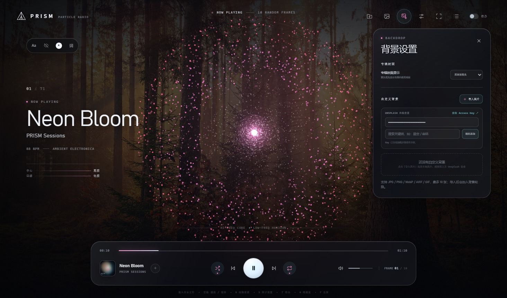

- 点击右上角的**背景设置按钮**（图片齿轮图标）打开独立面板。
- 打开 **背景设置 → 导入图片**。
- 支持 JPG / JPEG / PNG / WebP / AVIF / GIF / BMP，可一次选择多张；最多保存 **10 张**自定义背景。
- 导入后：
  - 图片会立即成为当前背景，并加入每次启动的 10 张背景轮换；
  - 设置面板里会显示缩略图，点击缩略图可立即切换；
  - 缩略图右上角的 `×` 可移除这张背景，移除后自动回到内置背景轮换。
- 自定义背景记录的是原始文件路径，**不会复制或上传图片**；下次打开会自动恢复。如果原文件被移动或删除，缩略图会标记为不可用，重新导入即可。
- 自定义背景列表保存在应用本地存储中（`localStorage`）。

#### 专辑封面

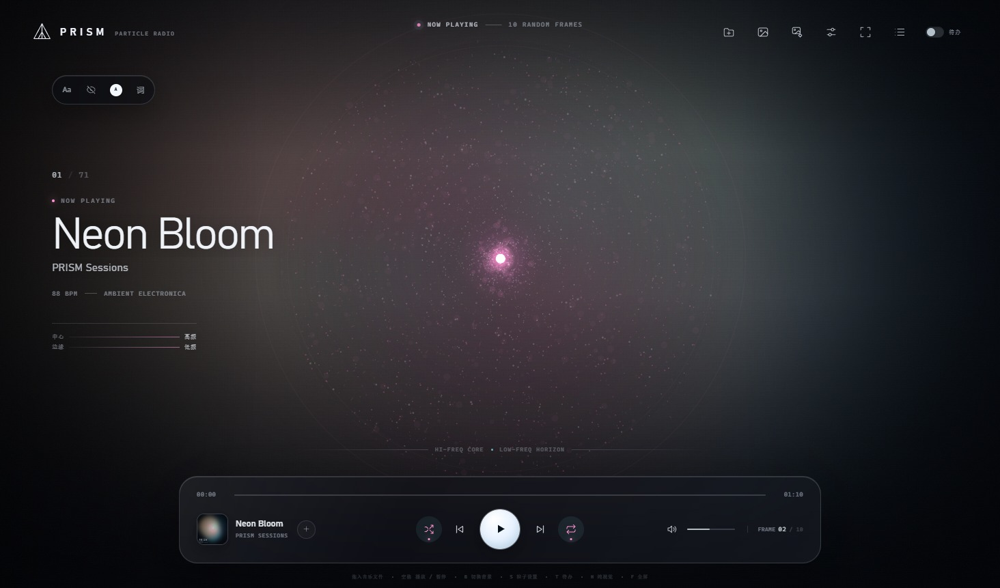

- 本地音乐优先读取音频内嵌封面（FLAC / MP3 / OGG 等），并支持同目录的 `cover.jpg`、`folder.jpg`、`front.jpg` 等封面文件。
- 有原专辑封面时，播放列表、底栏和专辑墙始终显示原封面。
- 有原封面时，播放页背景会自动切换为**同一张专辑封面的虚化背景**；没有可读取封面时保留随机背景。
- 按 `B` 或点击「换一张背景」可临时切回随机背景，切到下一首时会恢复封面虚化背景。
- 没有原封面时显示带曲名和歌手的 PRISM 占位封面，**不会再拿随机背景图冒充专辑封面**。
- **背景设置 → 专辑封面 → 专辑封面显示** 提供三档：
  - `原封面优先`（默认）：有内嵌封面就显示原封面，没有则显示占位图；
  - `缺失时 Unsplash`：有原封面时仍显示原封面，只有缺封面时使用 Unsplash；
  - `始终 Unsplash`：所有专辑卡片都使用 Unsplash 图，不显示原封面（需手动选择）。

#### Unsplash 在线背景

- 在**背景设置**面板中找到 **UNSPLASH 在线背景**。
- 首次使用需要点击「获取 Access Key」，在 Unsplash Developers 免费创建应用并复制 Access Key；Key 只保存在本机，**输入后自动保存**，下次打开无需再次输入。
- 填写关键词（例如「星空」「森林」）后点击 **「随机添加」**：
  - 联网调用 Unsplash 官方搜索 API，从最多 30 张横版结果中随机选择 1 张；
  - 添加到自定义背景并立即切换，后续进入 10 张背景轮换；
  - 图片使用 Unsplash 热链，不下载复制，因此显示和下次启动都需要联网；
  - 设置面板会显示摄影师署名和 Unsplash 链接。
- 受 Unsplash API 配额限制；如果 Key 无效、额度不足或网络不可用，会显示对应提示。

### 径向频谱粒子

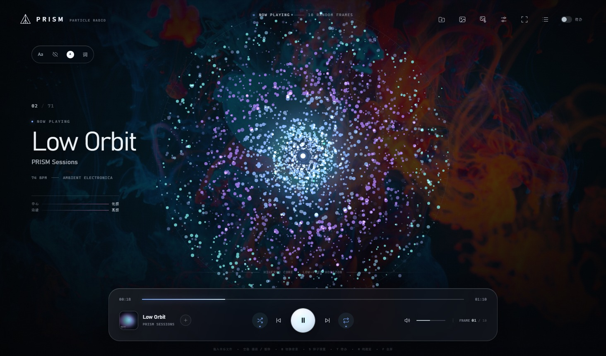

- 用 Web Audio 的 `AnalyserNode`（FFT 4096）读取音乐频谱，再映射成 56 个对数频段。
- 每个粒子带有独立的弹簧位移：低频命中时沿半径向外弹开，过冲后再回弹，而不是只做轻微平移。
- 鼓点通过波形峰值、低频上升和频谱通量共同检测；持续低频或没有明显瞬态的曲目会按曲目 BPM（未知时 100 BPM）补一个柔和的视觉脉冲，避免画面静止。
- 弹动同时作用于粒子半径、尺寸、亮度和外圈呼吸，幅度随「随音乐移动」滑杆增强；设为 `0` 可完全关闭弹动。
- 粒子的半径决定它采样的频段：**半径越小越靠中心，采样频率越低；最外围采样高频**。
- 约 3,080 个桌面粒子沿 26 个环形带分布，加上约 396 个低频核心粒子和 198 条向外漂移的星尘，形成从中心向外扩散的粒子场。
- 低频重拍会触发**柔和的扩散光带**（不再是硬边线圈）；每约 3.2 秒最多一次、同时最多 2 条。中心低频针状射线、核心粒子闪动与低频段对应。
- 频段采用平滑处理，避免逐帧抖动；窗口失焦时自动降低开销。

### 粒子旋钮与渐变颜色

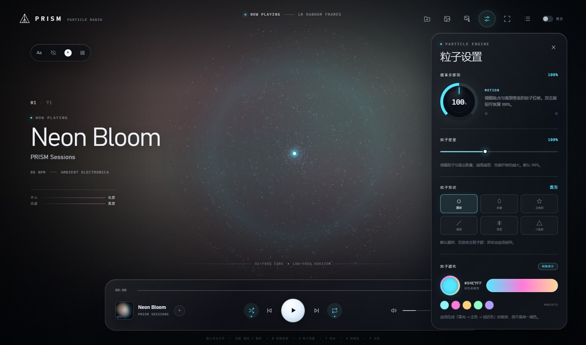

- 点击右上角的**调节按钮**（或按 `S`）打开粒子设置面板。
- **随音乐移动旋钮**范围为 `0–200%`，默认 `100%`：
  - 数值越大，粒子随低频鼓点、高频频段产生的径向位移、角度抖动和星尘外扩越强；
  - 数值越小，音乐带来的位移越弱，但环境中的缓慢旋转和闪烁仍会保留；
  - 支持垂直拖动、鼠标滚轮、方向键/PageUp/PageDown/Home/End；双击旋钮恢复 `100%`。
- **粒子密度**范围为 `40%–200%`，默认 `100%`：
  - 同时调整主粒子、核心粒子和星尘数量；
  - 数值越高越浓密，性能开销也越大；设置会自动保存。
- **粒子形状**支持 6 种，默认圆形：
  - 圆形、水滴形、五角形、线状、雪花形、三角形；
  - 同时应用到 2D 粒子与 3D 球形粒子（3D 下会自动放大精灵，保证形状可辨）；
  - 选择会自动保存，下次启动继续生效。
- **粒子颜色**支持系统取色器与 5 个预设色：
  - 选择任意主色后，会自动生成「浅色高光 → 所选主色 → 邻近色」的同色系渐变；
  - 内圈、中段、外圈分别使用渐变中的不同颜色，因此不是单一颜色；
  - 点击「跟随曲目」可恢复为当前歌曲自带的三色主题。
- **配色方案**：内置 15 套来自 [Color Hunt 热门榜](https://colorhunt.co/palettes/popular) 的四色配色（潮汐青 / 深海蓝 / 蜜桃 / 暮金 / 樱粉 / 薰衣草 / 夜航蓝 / 霓虹夜 / 珊瑚青 / 森棕 / 薄荷紫 / 苔原绿 / 落日玫瑰 / 极光 / 柠檬森）：
  - 点击后同时改变界面强调色与 2D/3D 粒子颜色；
  - 再点一次同一套配色可取消，恢复跟随曲目；
  - 选配色会覆盖自定义单色，重新选单色或「跟随曲目」则会退出配色方案。
- 旋钮数值与自定义颜色都会保存在本地（`localStorage`），下次打开继续生效。

### 3D 球形粒子（实验）

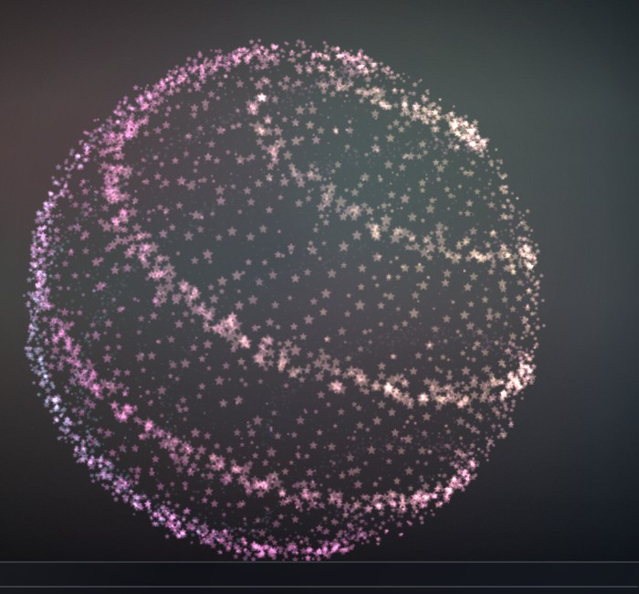

- 在粒子设置面板底部打开 **3D 球形**（或按 `3`），核心粒子会从平面径向频谱切换为一颗由 three.js 渲染的立体粒子球；关闭后立即回到原来的 2D 粒子。
- **粒子形状**同样作用于 3D 球体：六种形状会生成对应的精灵贴图，非圆形会自动放大，保证在球面上仍然可辨。
- **音乐明度**：粒子亮度跟随低频 / 中频能量与鼓点脉冲变化，安静时缓慢呼吸。
- **固定机位**：正面、斜角、侧面、俯视、仰视、近景 6 个机位，点击即切换，镜头沿球面做非线性过渡。
- **段落自动切机位**：根据频谱通量检测音乐段落变化，在段落交界处随机切换到另一个机位；可关闭，「段落灵敏度」控制触发阈值（越高越容易切）。
- **过渡曲线**：内置平滑、缓出、缓入、弹性 4 条 cubic-bezier 曲线，也可选择「自定义」并拖动 X1/Y1/X2/Y2 四点，面板中会实时预览曲线形状。
- **切换速度**：`40%–250%`，默认 `100%`（约 1.35 秒）；数值越大镜头飞到新机位越快，切换途中调整也会即时变速。
- 3D 模式与 2D 共用密度、随音乐移动和主题色设置；开启 3D 时会暂停 2D 引擎以节省性能，关闭后自动恢复。
- three.js 已内置在 `js/vendor/three.min.js`，不联网也能使用；WebGL 不可用时自动回退到 2D 粒子。

### 界面控制

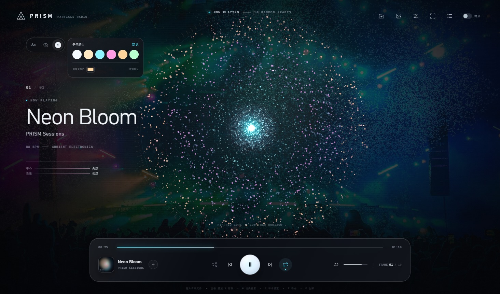

播放器左上角有一组界面按钮：

- **`Aa`：界面与字体大小**
  - 点击后拖动滑杆，可在 `80%–120%` 之间整体缩放界面和字体；
  - 背景与粒子保持原尺寸，只有 UI 层缩放；
  - 点击「恢复 100%」重置；设置会自动保存。
- **眼睛按钮：纯视觉模式**
  - 隐藏顶栏、曲目信息、播放器、按钮和所有文字，只保留背景与粒子；
  - 右上角会出现一个半透明的眼睛按钮，点击即可恢复界面；
  - 也可按 `H` 切换，或按 `Esc` 退出。
- **`A` 色点按钮：字体颜色**
  - 提供冷白、暖白、青、粉、金、薄荷 6 个预设；
  - 支持系统取色器自定义任意颜色；
  - 会统一改变界面文字颜色，点击「恢复默认」还原；
  - 字体颜色会自动保存，下次启动继续生效。

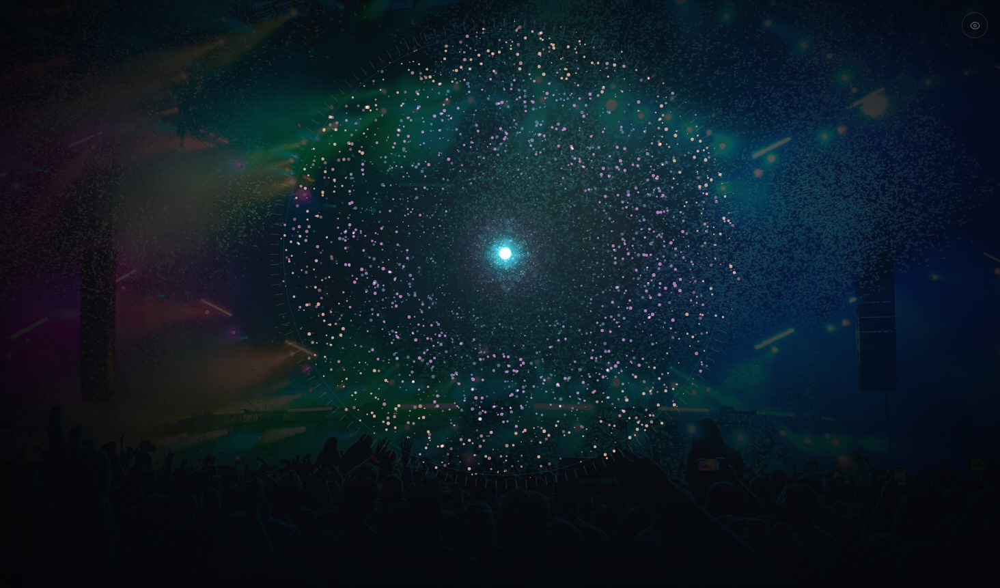

### 歌词

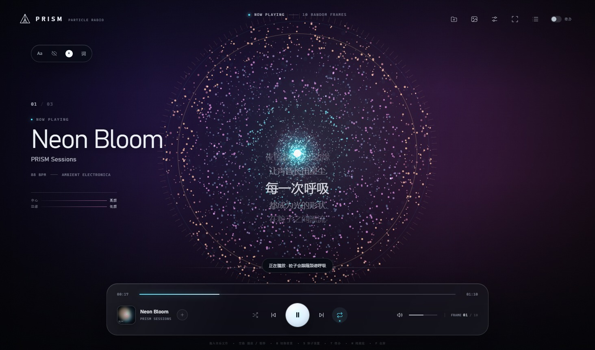

- 点击左上角 **`词`** 按钮打开歌词面板，或按 `L` 显示 / 隐藏歌词。
- 点击 **「导入 LRC」** 为当前歌曲选择 `.lrc` 文件；歌词会按时间轴自动同步。
- 歌词支持拖动定位：鼠标按住歌词文字拖到任意位置，点击「重置位置」恢复默认。
- 可调节：
  - 字体：无衬线 / 等宽 / 衬线 / 圆体；
  - 颜色：系统取色器；
  - 字号：`16–64`；
  - 透明度：`20%–100%`。
- 每首歌的歌词和所有样式设置都会保存在本地，切换歌曲时自动加载对应歌词。
- 歌词需要带 `[mm:ss]` 时间标签的 LRC 文件；没有时间标签的文本不会导入。
- 歌词字号单独控制，不受界面缩放影响；中英文使用同一套字体设置。
- 歌词以窗口方式上下滑动切换，不是瞬间替换。
- 「显示行数」支持 1–6 行，翻译行也计入显示行数；例如 6 行英文并开启翻译时显示 3 行英文和 3 行中文。

#### 在线搜索同步歌词

- 在歌词面板的「在线搜索同步歌词」中填写歌手和歌名，点击「搜索」。
- 使用 **LRCLIB** 公共歌词服务，无需 API Key，需要联网。
- 会自动选择匹配度最高、带时间轴的结果并导入保存。
- 只找到纯文本歌词或纯音乐时，会给出提示，不会生成错误的时间轴。
- 搜索词会默认填入当前歌曲的歌手和歌名，也可以手动修改。

#### 显示翻译

- 歌词面板中的「显示翻译」开关默认关闭。
- 开启后使用 **MyMemory** 将歌词机器翻译为中文，并显示在每一行歌词下方。
- 翻译结果按歌曲缓存，之后切换歌曲或重新打开会直接使用缓存。
- 需要联网；翻译服务额度不足或网络不可用时会在面板中提示。
- 已是中文的歌词会跳过翻译。

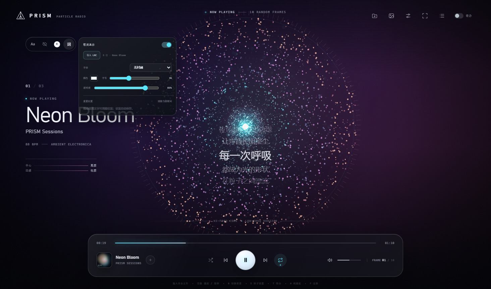

### 专辑墙

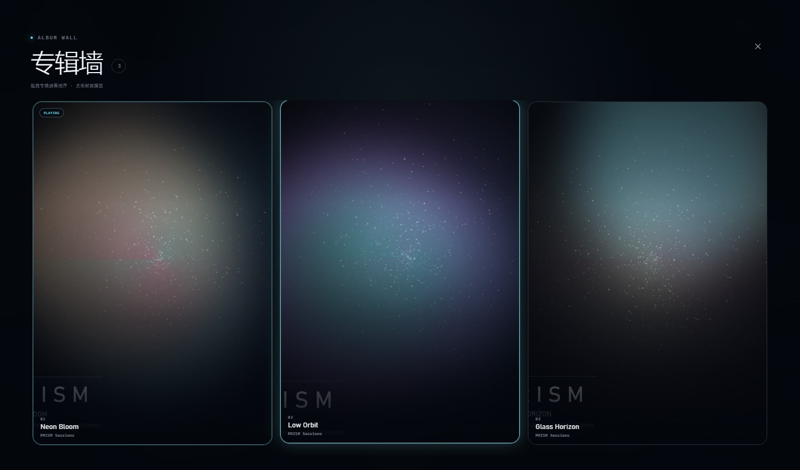

- 打开播放列表，点击右上角的**网格按钮**切换到全屏专辑墙。
- 整个屏幕以大幅专辑封面铺满，点击封面即可播放对应歌曲。
- 鼠标悬停在专辑上时，封面边缘会出现发光描边。
- 直接拖拽封面即可调整播放顺序；拖动期间当前播放歌曲保持不变。
- 拖到另一张封面上时，两张封面会以平滑动画交换位置：被指到的封面滑向被拖封面的原位置；同一次拖拽里再拖回原处会交换回去，可以反复调整。松手才提交新顺序，按 `Esc` 或拖到空白处松手则取消并回弹。
- 将封面拖到页面任意边缘（出现红色「松开删除」提示）后松手，即可从当前播放列表删除该曲目。
- 点击右上角 `×` 或按 `Esc` 返回播放列表。

### 待办事项

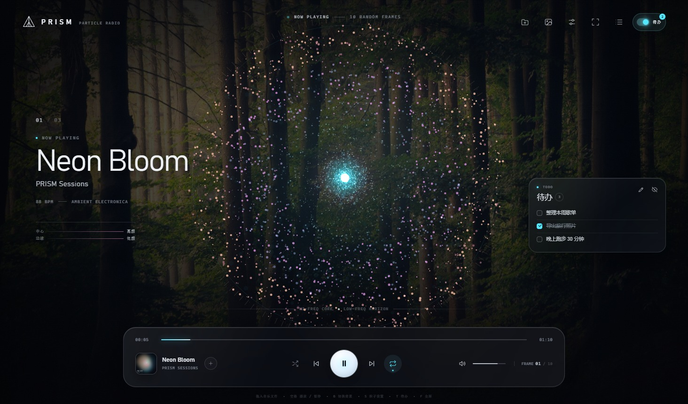

- 点击右上角的 **「待办」开关**（或按 `T`）显示 / 隐藏播放器右侧的待办清单。
- 开关打开后：
  - 没有待办时，右侧空白处会显示「添加待办」；
  - 已有待办时，右侧会显示轻量待办卡片；点击卡片上的铅笔按钮进入编辑面板，点击眼睛按钮可隐藏。
- 点击编辑面板右上角的关闭按钮（或按 `Esc`）只会收起编辑面板，已设置的待办会保留在播放器右侧空白处的卡片中。
- 在输入框写下待办，按 `Enter` 或点击 `+` 添加：
  - 勾选左侧复选框会标记完成并显示删除线；
  - 点击任务右侧的垃圾桶按钮可删除单项；
  - 点击 **「清除已完成」** 可一次删除所有已勾选任务。
- 点击 **「保存待办」** 后，待办会写入应用本地存储，下次打开 PRISM 时会自动加载并以右侧卡片显示，无需再次输入。
- 待办面板底部的**透明度滑杆范围为 0–100%**：数值越大越透明，`0%` 完全不透明，`100%` 完全透明；点击水滴按钮恢复默认 `45%`，该偏好会自动保存并同时作用于编辑面板和右侧待办卡片。
- 待办数量会出现在右上角开关旁的角标中（未完成数量）。
- 未点击保存前修改的内容会显示 `有未保存更改`，关闭应用后不会保留。

### 播放器逻辑

- 基于原生 `HTMLAudioElement` 的播放、暂停、进度、音量、静音、上一首/下一首。
- 播放模式：列表循环 / 单曲循环 / 关闭循环；随机播放。
- 本地导入支持 Chromium 可解码的常见格式（MP3 / WAV / FLAC / M4A / OGG 等）。
- 本地单文件通过 `Blob URL` 播放；文件夹导入直接播放原始文件路径。**不会上传，也不会写入磁盘**；关闭应用后自动清空播放列表。
- 内置三首原创合成演示曲：`Neon Bloom`、`Low Orbit`、`Glass Horizon`。

### 自动扫描音乐文件夹

- 点击右上角的**文件夹按钮**，或播放列表里的**「导入文件夹」**，选择一个电脑上的文件夹。
- PRISM 会自动递归扫描该文件夹及其子文件夹，识别 MP3 / WAV / FLAC / M4A / AAC / OGG / OPUS 等音频文件并加入播放列表。
- 支持按 `艺术家 - 歌曲名` 和 `01 - 艺术家 - 歌曲名` 解析文件信息；子文件夹名会作为专辑名。
- 同一路径的歌曲会自动去重；重复导入文件夹时只跳过已存在的歌曲。
- 最多扫描前 **1000** 首、最多进入 **10 层**子文件夹；隐藏目录、系统目录和符号链接会被跳过。
- 扫描只读取文件名和路径，不会移动、复制或修改原始音乐文件；播放时直接读取文件。

### 保存播放列表并自动恢复

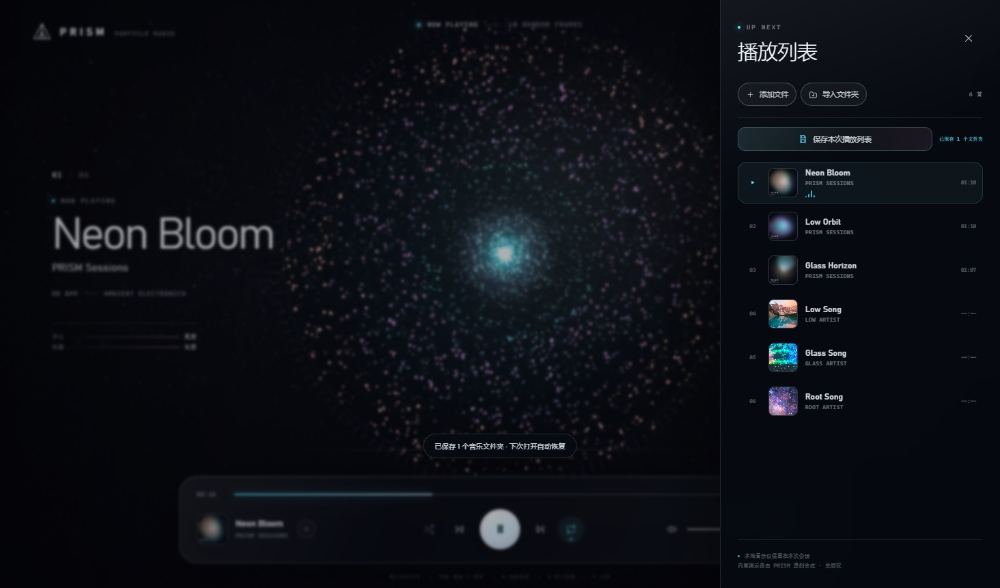

- 打开播放列表，点击 **「保存本次播放列表」**。
- PRISM 会把当前播放列表中所有音乐文件夹的路径保存到：
  `%APPDATA%\PRISM\saved-playlist.json`
- 下次打开应用时会自动读取这些文件夹、重新扫描音频并放回播放列表，不需要再次手动选择。
- 保存按钮旁边会显示当前状态：`有未保存更改` / `已保存 N 个文件夹` / `已恢复 N 首`。
- 保存的是**文件夹来源**，因此：
  - 文件夹里后来新增的歌曲，下次启动也会被自动发现；
  - 如果只删除了某个文件夹中的部分歌曲，下次启动仍会按文件夹完整扫描；
  - 文件夹被移动或删除时会跳过，并提示有文件夹不可用。
- **单文件导入仅保留在本次会话**；需要跨启动恢复的音乐请通过「导入文件夹」加入。

### 桌面壳

- Electron 45 原生窗口，直接通过 `file://` 加载本地页面、图片和音频。
- 没有地址栏、没有浏览器标签页、没有 `localhost` 服务。
- 关闭窗口即退出；系统标题栏显示 **PRISM · 粒子音乐播放器**。

## 目录结构

```text
prism-player/
├─ index.html                 播放器页面
├─ package.json               Electron 桌面壳与打包配置
├─ electron/
│  ├─ main.js                 原生窗口入口（本地 file:// 加载）
│  └─ preload.js              安全的文件夹选择 IPC 桥
├─ scripts/pack.js            生成 release/PRISM/PRISM.exe
├─ css/style.css              视觉系统、响应式布局、欢迎页
├─ js/
│  ├─ data.js                 背景池 + 内置曲目（构建时嵌入，运行时无 fetch）
│  ├─ particles.js            Canvas 粒子/频谱可视化引擎
│  ├─ particles3d.js          three.js 3D 球形粒子（实验）
│  ├─ vendor/three.min.js     本地 three.js 构建（r149）
│  └─ player.js               播放器、播放列表、背景轮播、快捷键
├─ assets/
│  ├─ audio/                  3 首内置 MP3
│  ├─ covers/                 3 张粒子风格封面
│  ├─ backgrounds/            23 张预下载 Unsplash 照片 + CREDITS.md
│  ├─ prism.ico               Windows 应用与快捷方式图标
│  └─ favicon.svg
├─ tools/                     素材生成脚本
│  ├─ fetch_backgrounds.py    重新下载 Unsplash 图池
│  ├─ make_music.py           合成演示音乐与封面
│  ├─ make_icon.py            生成 Windows 图标
│  └─ build_data.py           生成 js/data.js
├─ docs/                      预览图
├─ pnpm-workspace.yaml        pnpm 依赖布局设置
└─ README.md
```

## 开发与重新打包

以下步骤只在修改源码或重新生成发布版时需要，普通使用不需要。

```powershell
# 安装开发依赖（Electron + packager）
pnpm install

# 直接以桌面窗口运行开发版（同样不启动浏览器）
pnpm start

# 生成 release/PRISM/PRISM.exe
pnpm pack:win
```

首次安装 Electron 时可能较慢。打包完成后将 `release/PRISM` 整体复制到目标目录，并把快捷方式指向 `PRISM.exe` 即可。

### 调整粒子

打开 `js/particles.js`：

- `BAND_COUNT`：对数频段数量，默认 56。
- `_buildParticles`：粒子数量、环形带密度、核心密度分布。
- `_updateSpectrum`：频谱采样范围（当前 36 Hz–10 kHz）与高频增益。
- `maxR`、`this.cy`：粒子球半径与屏幕位置。
- `setPalette` / `track.palette`：粒子颜色。

打开 `js/player.js` 中的 `initAudio()` 可调整 `AnalyserNode` 的 FFT 大小、`minDecibels` / `maxDecibels` 和频段灵敏度。

### 更换背景池

1. 将图片放进 `assets/backgrounds/`。
2. 更新 `tools/backgrounds.json`（`file` 指向图片，另可设置 `title`、`mood`、`luma`）。
3. 运行：

```powershell
py -3 tools/build_data.py
```

如果要重新从 Unsplash 下载图池，编辑 `tools/fetch_backgrounds.py` 里的 `PHOTOS` 列表后运行它。

### 重新生成内置音乐

`tools/make_music.py` 使用 numpy 合成三首曲子，并用 ffmpeg 写入 MP3 封面与 ID3 信息。需要本机有 `ffmpeg`：

```powershell
py -3 tools/make_music.py
py -3 tools/build_data.py
```

脚本会生成 `assets/audio/*.mp3`、`assets/covers/*.jpg` 和 `tools/tracks.json`。

## 兼容性与说明

- 目标平台：Windows 10/11 x64。应用自带 Electron/Chromium，不依赖系统浏览器。
- 欢迎页、粒子 Canvas、`backdrop-filter`、`color-mix` 都在应用内置 Chromium 中运行。
- 背景图与内置音乐全部随应用离线提供，运行时不会发起网络请求。
- 内置音乐与封面为项目原创合成，可随播放器自由使用；Unsplash 照片遵循 Unsplash License（无需署名，但本项目仍保留来源链接）。

## 已验证

- 打包后的 `PRISM.exe` 从本地 `resources/app` 加载页面、照片和 MP3；
- Web Audio 频谱分析在 `file://` 下正常工作，粒子场会随音乐振动；
- 播放/暂停、进度、切歌、音量、真实本地文件播放；
- 原生文件夹选择、递归检测音频、自动去重并导入播放列表；
- 支持导入本地图片作为自定义背景，并加入随机背景轮换；
- 本地音乐自动读取内嵌专辑封面，缺封面时显示占位图；
- 有原封面时播放页自动使用专辑封面虚化背景；
- 背景设置独立于粒子设置，入口在右上角；
- 支持联网检索 Unsplash 并随机添加一张背景；
- 播放列表保存到本地并在下次启动时自动恢复；
- 本地音乐导入后自动预读时长并显示在播放列表，无需逐首播放；
- 播放列表支持按歌名、歌手、专辑或文件夹搜索；
- 可输入、勾选完成、删除并保存的待办清单，下次启动自动显示；
- 待办预览框可拖动，位置自动保存，双击标题栏恢复默认；
- 界面/字体缩放、纯视觉隐藏文字、字体颜色自定义；
- 歌词显示与 LRC 导入，支持位置、字体、颜色、字号、透明度；
- 歌词字号独立于界面缩放，中英文统一字体设置，支持 1–6 行显示和上下滚动切换；
- 支持按歌手 + 歌名从 LRCLIB 在线搜索同步歌词；
- 歌词支持 MyMemory 中文机器翻译与显示开关；
- 全屏专辑墙，支持拖拽排序和悬停发光；
- 专辑墙支持拖拽到页面边缘删除曲目；
- 粒子运动旋钮、同色系渐变取色、设置持久化；
- 粒子低频弹簧弹动、鼓点检测与回弹；
- 粒子密度 `40%–200%` 可调；扩散冲击改为柔和光带；
- 粒子形状可选圆形、水滴、五角形、线状、雪花、三角形；
- 不使用 `localhost` / HTTP 服务，不会启动 Chrome 或 Edge；
- 通过桌面快捷方式经 Explorer 启动成功，窗口标题为 `PRISM · Neon Bloom`，进程响应正常；
- 窗口内容 1464×861 与浏览器预览 1600×1000 布局正常。
